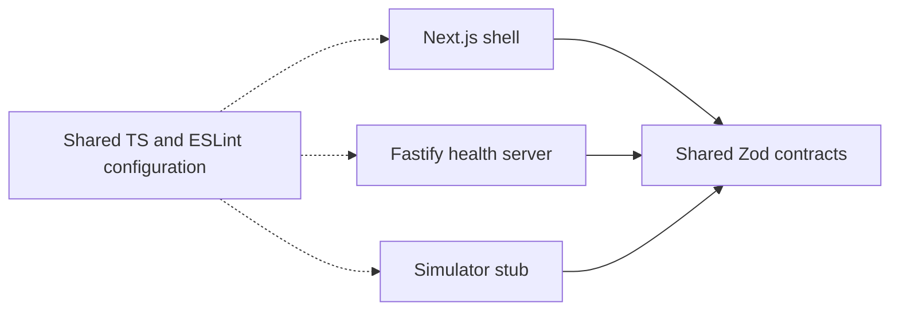
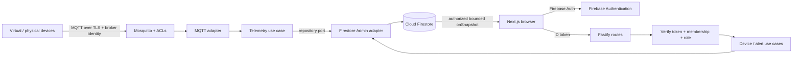

# Architecture

## Current foundation

The monorepo separates independently deployable web, API, and simulator applications from browser-safe shared contracts and tooling. Only the web shell and API health routes execute application-facing behavior today. Firebase/MQTT packages are installed but their production adapters are not implemented or connected.

## Planned runtime flow

All MQTT-to-Firestore and browser data arrows are planned, not current functionality.

## Layer boundaries

- `modules/*/domain`: pure models and policies; imports shared contracts or other domain code, never Fastify/Admin/MQTT.
- `modules/*/application`: use cases and narrow dependency ports. Inject repositories, clock, event identity/dedupe policy, and publisher only where required.
- `modules/*/http`: parse/validate requests, call use cases, map errors to HTTP. No persistence policies here.
- `infrastructure/firestore` and `infrastructure/mqtt`: SDK adapters implementing application ports.
- `app.ts`: injectable server factory, route registration; `server.ts`: configuration and process lifecycle. Connect and close future adapters here through explicit factories, without a DI framework.
- `web/src/features`: client feature boundaries. Client Firebase initialization is lazy, with emulator safeguards. No direct sensitive writes.
- `simulator`: configuration, virtual-device state, metric generators, MQTT publisher, scenarios. Its Phase 0 entrypoint explicitly publishes nothing.

Avoid speculative repositories or general-purpose base services before use cases need them. README placeholders preserve the intended boundaries without pretending implementations exist.

## Planned ingestion policy

1. Reject oversized messages before JSON parsing; enforce exact topic shape `tenants/{tenantId}/devices/{deviceId}/telemetry` and safe identifiers.
2. Establish broker-authenticated device identity and tenant assignment; compare topic and payload IDs. Payload agreement does not prove identity.
3. Parse the strict shared telemetry DTO. Enforce server-clock freshness separately (initial proposal: maximum age 120s, future skew 30s); make this deterministic with an injected clock.
4. Verify device registration/active status. Use tenant/device/eventId as an idempotency scope.
5. Transactionally deduplicate with bounded, expiring receipt records; reject out-of-order updates so latest state cannot move backwards.
6. Throttle latest writes (proposed 5s per device) with a defined trailing flush; sample history (proposed 60s) or aggregate, independent of dedupe receipts.
7. Define crash/retry and acknowledgement behavior before claiming at-least-once delivery. MQTT QoS 1 does not itself make the database transaction and broker acknowledgement atomic.

These policies are TODOs for Phases 2–4. The shared schema validates shape/ranges; it deliberately does not apply a moving wall-clock cutoff.

## Failure modes

| Failure                             | Required future behavior                                                                                |
| ----------------------------------- | ------------------------------------------------------------------------------------------------------- |
| Broker unavailable                  | Bounded reconnect backoff/jitter; readiness false; no unbounded offline publisher queue                 |
| Invalid/unregistered telemetry      | Drop with structured reason and bounded metrics; no secret/raw-payload log dump                         |
| Duplicate event                     | Idempotent acknowledgement without duplicate state/history side effects                                 |
| Out-of-order event                  | Preserve newest event-time state; separate server receipt time                                          |
| Firestore unavailable               | Bounded retries/backpressure; readiness false; document durable replay/dead-letter policy               |
| Process crash during buffered write | Explicit durability/replay policy; no claim that in-memory throttles are durable                        |
| Membership revoked                  | Firestore read rules deny subsequent reads; listeners surface errors and unsubscribe                    |
| Last-seen timeout                   | Backend scheduled detection, not browser inference; status updates separated from high-frequency writes |

The current `/ready` endpoint covers only the scaffold process. Replace its explicit `integrations: not-connected` response with real dependency probes when adapters become required.

## Deployment boundaries

Web, API, and simulator have independent build outputs. Current Compose runs local infrastructure only. Production Docker images, hosting, TLS, broker authentication, secret delivery, horizontal ingestion coordination, worker scheduling, and observability exporters are later milestones. No Site or cloud resource is created during this setup.
